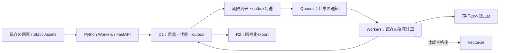

# LATCH：既存コードを活かすCloudflare移行計画

実装担当向けの前提・技術情報

> **For agentic workers:** REQUIRED SUB-SKILL: Use superpowers:subagent-driven-development or superpowers:executing-plans to implement this plan task-by-task. Steps use checkbox (`- [ ]`) syntax for tracking. この文書は未承認の計画案であり、実行の許可ではない。実装・実データ移行・デプロイは、ユーザーが明示的に承認した範囲で行う。

**Goal:** LATCHの画面・業務ルール・Pythonコード・試験資産を可能な限り残し、Cloudflare中心の構成へ段階的に移行する。費用削減と、候補発見・安全性・待ち時間の維持を両立する。

**Architecture:** Python Workers＋FastAPIの互換性を最初に検証し、DBアクセスと実行環境を差し替える。D1を状態の正とし、Queuesで仕事を届ける。検索は正確な条件判定を先に移植し、Vectorizeは比較試験を通過した場合に追加する。

**Tech Stack:** Python 3.13以上／FastAPI／Pydanticを再利用候補とする。移行先はWorkers、D1、Queues、Cron Triggers、Static Assets、R2。VectorizeとDurable Objectsは必要性を検証して採否を決める。外部LLMは最初の比較では現行モデル・promptを維持する。

**Spec:** この文書の§1〜§5が設計案、§6が実施タスク、§7〜§9が判定・切替条件。設計と計画を一つのMarkdownにまとめた。承認後も、互換性や同時更新の検証で設計が変わった場合は差分を提示する。

作成日：2026-10-08。状態：レビュー待ち。本書作成時に実装・サービス操作・外部LLM試験・実データ移行は行っていない。コードと既存結果の静的確認、公式情報の照合を行った。試験項目のチェックボックスはすべて将来の作業を示す。

**画面とマッチングのルールを残し、保存先と仕事の動かし方をCloudflareへ移す。** サーバー側もまず既存のPythonを使う。Cloudflareで動かない部分だけを書き換える方針である。飲食以外にも広げるため、意思・条件・同意・提案の仕組みを共通部分として残す。

| 段階 | 何をするか | ここで確認すること |
|---|---|---|
| まず、動かせるか確かめる | Pythonと認証・LLM通信を試し、残せるコードを決める | 全面書き直しが本当に必要か |
| 次に、裏側を移す | DB、仕事の配送、再評価を交換し、改善を個別に測る | 候補・成立・削除・待ち時間が変わらないか |
| 最後に、節約効果と切替を確かめる | 組合せの効果を比べ、データ変換と戻す手順を試す。候補削減は別実験 | 安くなった理由と、品質への影響を説明できるか |

月額1,000〜3,000円は目安とする。最初に減らすのは重複したAI呼出しと不要な再評価で、候補を減らす案は最後の別実験にする。現時点では、新構成の動作・費用を実測していないため、金額や削減率を保証しない。

方針の確認には§1・§2・§5・§8、実装担当には§3・§4・§6、切替の判断には§7とT12が対応する。

## 1. 移行の目的と、守るユーザー体験

月額1,000〜3,000円は費用対効果を考える目安であり、厳格な上限ではない。金額到達を理由に、通常利用の受付・評価・候補数を自動で制限する方針は採らない。利用量が増えた場合は、費用と品質を報告して予算を再判断する。

ユーザーは、今と同じように意思を入力し、条件に合う相手・機会の提案を受け、承認・辞退できる状態を目指す。節約だけを理由に入力方法や通知を変更しない。

### 守る方針（Global Constraints）

- 今回承認された作業は計画書作成まで。既存ソース・設定・既存文書は変更しない。
- 今後、一度の承認が実装・検証・配備を含む場合はその範囲で進める。文中の「別承認」は、すでに承認された作業の再確認を要求するものではない。
- 実装時も画面と`/v1` APIの入出力・エラー・公開範囲を原則維持する。仕様変更は差分として承認を得る。
- 条件判定、双方の意思確認、非公開性、同意、ブロック、削除、年齢条件を維持する。
- Pythonコードの再利用を優先し、TypeScriptへの全面移植は既定にしない。
- モデル・prompt・Jev枠・提案閾値を、基盤移行と同時に変更しない。
- 現行の業務上限とD-16の回数guardは比較基準として維持する。月額目安に合わせた縮小は別判断とする。
- DB内の状態更新は原子的に扱う。外部LLM・push送信まで含むexactly-onceは保証しない。
- 未登録Parser送信、入力長、再試行・再評価等の既知問題は「維持すべき仕様」と混同しない。既存の承認記録と照合し、修正による挙動差を明示する。
- ログ・メトリクス・Queueに原文や条件本文を載せない。新しいキャッシュも削除・同意の対象とする。
- 飲食固有の条件を共通基盤へ固定しない。将来の外部条件・片側だけの機会にも拡張できる境界を残す。

### 重点的に確認する失敗例（Review Focus）

| 見落としやすい条件 | 期待する挙動 | 担当タスク |
|---|---|---|
| 読取後にブロック・削除・同意撤回が届く | 古い評価を使って公開・提示しない | T3、T6、T9 |
| LLM送信後に応答やDB保存だけ失われる | 課金結果が不明な試行を記録し、無条件の再送をしない | T5 |
| 日跨ぎ・誕生日・距離／時刻の境界 | 旧版の条件判定と一致し、相対日時の解析を流用しない | T4、T7 |
| 評価を抑制している間に新しいIntent版が届く | 最新版への評価依頼を消さず、後で回収する | T8 |
| 切替後の書込み、またはバックアップ後の削除 | 巻き戻しで回答を失わず、削除済み情報を復活させない | T10、T12 |

## 2. 画面と業務ルールを残し、環境依存部分を交換する

### 2.1 前回の説明から修正する点

公式にはPython WorkersでFastAPIがサポートされている。前回説明の「サーバー側を大部分TypeScriptへ書き直す」は必須ではない。再利用を優先する本計画では、Pythonで動かせる範囲を確認してから、動かない依存だけを交換する。[FastAPI公式対応](https://developers.cloudflare.com/workers/languages/python/packages/fastapi/)

ただし、FastAPI対応はLATCHの依存全体の対応を意味しない。現行は`main.py`のlifespanでDB・Redis・Pub/Subと永続taskを組み立て、認証のJWKS取得では`asyncio.to_thread`を使う。Workersでは起動処理・通信・状態の置き場所を分ける必要がある。[現行起動処理](../../../backend/src/latch/main.py)、[依存一覧](../../../backend/pyproject.toml)、[JWKS検証](../../../backend/src/latch/auth/idp.py)、[Python標準ライブラリの制約](https://developers.cloudflare.com/workers/languages/python/stdlib/)

「再利用できる」は静的な候補であり、Workers上で動作を確認した結果ではない。T1の結果で次のいずれかを選ぶ。

| 選択肢 | 再利用と交換の範囲 | 採否の条件 |
|---|---|---|
| A：Python Workers主体（第一候補） | routes・Pydantic・純粋計算・promptを残し、D1／通信／job adapterを交換 | 依存・認証・binding・実測性能がT1を通過 |
| B：薄いTypeScript入口＋Python処理 | 非対応のイベント入口や暗号処理だけ交換。業務判定はPythonに残す | 二重実装せず、内部呼出しの認証・遅延・運用を検証できる |
| C1：TypeScript主体 | Python互換性が不成立の場合の代案。期待結果・prompt・画面は残す | T1失敗時に書き直す範囲・工数・費用を再提示 |
| C2：PostgreSQLを残す | D1で業務状態を安全に確定できない場合の代案。Python再利用とは別判断 | T3失敗時にDB接続・運用・費用を再比較。自動で進まない |

### 2.2 再利用する資産を先に分ける

| 現行の資産 | 方針 | 根拠・注意点 |
|---|---|---|
| `frontend/src/`、`frontend/tests/` | 画面とVitestを再利用 | 配信・接続設定を交換。解析の1秒debounce等も維持 |
| `intents/schema.py`、`intent_input.py`、`completion.py`、`prompt.py` | スキーマ・補完・promptを再利用候補にする | 入力長等の既知不足は別の変更として扱う |
| `worker/matching/layer3.py`、`worker/embedding_text.py`、`llm/jev.py` | Pythonの計算・整形を再利用 | 安価な判定、正規化文、7設問の検証を作り直さない |
| `latch_calc.py`、`group_calc.py`、`proposal.py`、`latches/calibration.py` | DB非依存部分を抽出して再利用 | `latch_calc`からSQLAlchemy依存の`layer4`へJST helperのimportがあるため、先に依存を外す |
| 各APIのroutes・schemas・errors | 契約と可能なコードを維持 | 現ServiceのSQLAlchemy依存はadapterで隠すだけでは済まない箇所がある |
| `intents/store.py`、`latches/store.py`、matchingのSQL | D1用repository／commandへ交換 | PostgreSQL配列、JSONB、PostGIS、行ロックの意味まで移す |
| `llm/providers.py`、`gateway.py`、`anthropic.py`、`gemini.py`、`typesafe.py` | provider境界・prompt・検証を維持 | SDK互換を検証。不適合時のみHTTP transportへ交換し、試行ごとのusageを追加 |
| G1・G2のgoldset、loadgen、既存integrationのシナリオ | 比較入力と期待結果として再利用 | SQL文字列固定test・asyncpg fake・PostGIS fixtureをD1の証拠にはしない |
| 既存compose、Alembic、PostgreSQL実装 | 移行中は比較基準・復旧経路として残す | D1 migrationを別系列にする。合格前に旧系を削除しない |

参照：[解析送信制御](../../../frontend/src/intent/parseFlow.js)、[Cheap Judge](../../../backend/src/latch/worker/matching/layer3.py)、[JST helper依存](../../../backend/src/latch/worker/matching/latch_calc.py)、[G1資産](../../../docs/testassets/g1-parser-struct.yaml)、[G2資産](../../../docs/testassets/g2-jev-goldset.yaml)。

### 2.3 完成形は小さく始める

以下は現在の設計・staging構成からの置換表であり、GCP本番にすべて配備済みという意味ではない。[既存構成](../../../docs/04-system-architecture.md)、[本番構成の費用試算](../../../docs/reviews/phase0-cloud-cost-estimate.md)

| 現行の役割 | 移行先 | 作り変える部分 |
|---|---|---|
| Web画面の配信 | 静的ファイル配信のStatic Assets | Viteの成果物を配信。画面とURLを維持 |
| API・Matching Worker | サーバーコードを動かすWorkers | 起動処理、依存注入、通信・job入口 |
| PostgreSQL＋PostGIS＋pgvector | DBのD1＋Workersの条件・距離・類似度計算 | schema、SQL、原子的な状態更新。Vectorizeは後で比較 |
| Pub/Sub・常駐relay | 仕事を配送するQueues＋D1 outbox | 二重配送、失敗回収、ackの扱い |
| 常駐の再評価・期限処理 | 定期起動のCron Triggers＋D1 schedule | 次回時刻と未処理世代の永続化 |
| Redisのsession・失効・counter・抑制 | D1の期限付き状態と原子的なcommand | TTL、single-use、競合時の回数を移植。初期案にKVは使わない |
| バックアップ・監視 | Time Travel、R2、Workersログ＋永続集計 | 復元、削除再適用、通知・費用集計 |
| 外部AI・FCM | 最初は現行の外部サービスを維持 | SDKが動かない場合の通信adapter。未実装pushは別に完成 |

D1に最新状態を保存し、判断の根拠にする。仕事の配送待ち記録（outbox）もここに置く。QueueとVectorizeは処理・検索を助けるが、現在の同意・ブロック・期限・成立可否を決める根拠にはしない。APIとjob処理は役割を分けるが、小規模段階から多数の独立サービスを作らない。

Workersでは現在の`latch.main:app`をそのまま起動しない。専用の組立処理で必要なrouteとserviceを注入する。起動時にuvicorn、Redis接続、Pub/Sub subscriber、永続relayを読み込む依存を外す。リクエストごとのenv・認証状態を可変のグローバル`app.state`で共有しない。

## 3. D1で成立・削除・回答を一度に確定する

### 3.1 データの形を合わせる

UUIDは既存APIと同じ文字列表現、日時はUTCの整数マイクロ秒で保存し、APIでは既存のISO 8601表現へ戻す。JSTの業務日と年齢計算は既存Clock・helperを再利用する。JSONBの交換先はJSON文字列だけでなく、検索・一意性・FKに必要な列と関係テーブルも用意する。

新規テーブルの設計対象は、`latch_members`、`latch_responses`、`group_members`、`intent_match_ownership`、`commands`、`jobs`、`outbox`、`evaluation_cache`、`llm_attempts`、`intent_evaluation_schedule`、`deletion_tombstones`。既存のusers・intents・blocks・latches・messages・notifications・calibrationの意味は維持する。最終DDLはT3でschemaと制約を確認して確定する。

配列を正規化する際は、参加者の表示順、同一ユーザー排除、3〜4人の人数条件、組合せの正規形、open提案の重複、回答者の一意性まで試験する。JSONの読み書きが成功しただけでは移植完了としない。

### 3.2 `engine.begin()`の模倣を作らない

現行の回答処理は、読取→Pythonで状態計算→回答追加→全Intent成立→競合提案取消→通知・calibrationを一つのtransactionで行う。D1の`batch()`は準備済みSQL群の原子的な実行を保証するが、途中のSELECT結果でPythonが分岐するinteractive transactionではない。[現行回答処理](../../../backend/src/latch/latches/service.py)、[D1 batchの公式説明](https://developers.cloudflare.com/d1/worker-api/d1-database/)

このため、DB操作の境界（repository）は業務command単位で提供する。

| 提案するinterface | 戻り値・保証 |
|---|---|
| `apply_intent(command_id, expected_revision, mutation, now) -> CommandResult` | 意思の保存・版更新・outboxを同時に確定 |
| `apply_response(command_id, expected_revision, response, now) -> CommandResult` | 回答、全員の状態、競合取消、通知job、calibrationを一括確定 |
| `apply_safety(command_id, mutation, now) -> CommandResult` | block・同意・削除と、関連する公開／提案状態を一括確定 |
| `apply_proposal(command_id, expected_revisions, proposal, now) -> CommandResult` | 最新条件・公開可否・業務上限を確認して提示と通知jobを確定 |

`CommandResult`は`applied / conflict / rejected`、保存済みのAPI応答、revisionを持つ。`command_id`は内部再配送を識別するもので、既存APIの二度目の回答に対する409を成功200へ変えるものではない。

Pythonで読んだsnapshotから計算した場合は、参照したrevisionと必要な条件をSQL側で再確認する。batch中に今回のcommandが成立したことを表すmarkerを作り、後続の通知・状態イベント・calibrationはそのmarkerに従属させる。条件付きUPDATEが0行でもSQLエラーではないため、失敗時に副作用が残らないことを実DBで試験する。

巻き戻し用のjournalも業務更新と同じbatchで保存する。API応答だけでなく、旧DBへ再適用できる変更内容・順序・版を持ち、回答・成立・メッセージ・安全状態・session失効・counterと、処理済み通知／LLM試行への参照を含む。replayは状態の再適用だけを行い、LLMや通知を再送しない。本文を含むjournalはバックアップと同じ機微データとして保護し、監視ログには載せない。

削除・同意撤回は、まず対象を利用不可にする状態と削除jobを同時に確定する。大量の関連データを物理的に消す作業は、その後に小さなbatchで再開可能に進める。物理削除が途中でも、API・検索・cache・遅延応答から対象へアクセスできないことを先に保証する。blockと成立取消等の即時に必要な業務状態も、commandで確定する。

共有Intentを持つ複数Latchの成立は、Intentの成立所有権を一意制約で保護する。LatchごとのDurable Objectを置くだけでは、この競合を防げない。またDO内のtransactionとD1のremote書込みは一つのtransactionにならない。D1で安全に表現できないcommandが残った場合はT3を不合格とし、DOを状態の正にする案かPostgreSQLを残す案を別途比較する。[DO storageの境界](https://developers.cloudflare.com/durable-objects/api/sqlite-storage-api/)

### 3.3 検索は正確な方式を先に移す

最初は、D1でカテゴリ・時間・予算・人数・同意・block等を絞り、距離判定の候補範囲を取得する。WorkersでWGS84楕円体の距離を確認し、全通過候補のcosineを計算して上位50件を選ぶ。続くCheap Judge・グループ計算を再利用する。距離範囲やcosine計算前の恣意的なLIMITは置かない。

小規模では一度の読取で候補を取得する。多い候補は`create_retrieval_snapshot(origin_id, expected_revision, now)`で、検索元と候補のID・版・条件・Embeddingを固定した短期の検索集合を作り、cursorで分割して読む。D1の複数readやsessionを、一つのDB snapshotと見なさない。集合の作成はSQLによる原子的な保存を候補とし、T3/T4で実現性・追加書込費用を検証する。削除・同意撤回時はこの集合も無効化し、提示直前に最新状態を再確認する。

上位候補の計算途中状態を永続化して再開可能にし、処理上限を超えた候補を黙って切り捨てない。延期・別実行方式・Vectorizeへの変更を、品質と遅延の結果から判断する。

PostGISの`geography`を単純な球面距離へ交換すると境界判定が変わり得る。互換の距離計算を検証し、近似を許容する場合は仕様変更として提示する。地名・曖昧表記・地域表示も、既存のISJ／OSM取込み結果と対応させる。ネイティブ依存の地理データ取込みはローカルの既存CLIを残し、D1へ変換した成果物をimportする。[現在の条件](../../../backend/src/latch/worker/matching/layer1.py)、[検索順序](../../../backend/src/latch/worker/matching/layer2.py)、[地名処理](../../../backend/src/latch/geo/service.py)

VectorizeはT9で正確検索との比較後に判断する。意味が近い上位候補を取ってから条件で落とすだけでは、候補の取りこぼしを回復できない。粗い条件filter、必要件数、更新反映、削除、同点の扱いを含めて比較する。[Vectorize filter](https://developers.cloudflare.com/vectorize/reference/metadata-filtering/)

## 4. 仕事と外部呼出しを永続的に追跡する

意思の保存とoutboxを同じD1 batchに入れる。Queuesへ届ける内容は`event_id / intent_id / intent_version / reason / due_generation / writer_generation / payload_schema_version`のみとし、原文・条件本文を含めない。`writer_generation`は切替時の書込権の世代で、旧環境の遅れた処理を拒否する。Queue送信とD1更新は別操作なので、二重配送を前提にする。[配送保証](https://developers.cloudflare.com/queues/reference/delivery-guarantees/)

`jobs`に処理状態、試行回数、`next_due_at`、lease期限、fencing tokenを持たせる。leaseは一定時間だけ処理を担当する権利である。fencing tokenはその世代であり、期限後に古い処理が戻っても結果を保存させないために使う。Intent版、job世代、処理権を確認した時だけ結果・次のoutboxを確定する。外部API待ちの間はDB transactionを保持しない。

leaseは各処理のtimeoutより長く設定する。初期案はJev30秒、Parser30秒、Embedding15秒とし、T1・T5の実測で調整する。回収は`running / succeeded / retryable / outcome_unknown / obsolete / failed`を区別する。Queuesのackは結果の永続化後に行う。

LLM送信後のtimeout・停止では「結果は不明だが課金された可能性がある」状態を残す。providerに有効なidempotency機能や結果照会がある場合は利用する。ない場合は、lease切れを理由に直ちに同じLLMを送信し直さない。可用性と追加課金を比較し、回数を限定した回収・fallback方針をT5で確定する。通常の並行重複は防ぐが、障害時の二重課金ゼロは約束しない。

試行は応答後に初めて記録するのではなく、送信前に`attempt_id`と`prepared`を永続化する。送信予定を記録してから通信し、応答・失敗・結果不明を同じIDへ追記する。通信とDB更新の間には「送信したか確定できない」境界が残るため、usage不明を0円として計上しない。

## 5. 六つの改善は、既存機能との差分を測って採否を決める

### 5.1 共通の比較方法

改善なしの移植版をB0とし、同じデータ・Clock・モデル・prompt・閾値・候補枠で各施策を一つずつ比較する。最後に組合せ版を比較し、効果を単純に足し合わせない。移植前のPostgreSQL版は正しさの参照として使う。

I1・I3等は移植版にも組み込むため、試験環境で施策ごとの比較モードを用意し、fixtureと記録済みLLM結果でB0を再現する。重複防止を外した比較版は通常利用へ配備しない。

比較入力は、既存G1/G2、M4 seed、既存integrationシナリオに、同時更新・失敗・日跨ぎ・高密度地域・3〜4人グループを追加する。単体の決定的試験ではfake Clockと記録済みLLM結果を使い、外部呼出し回数を正確に数える。性能はWorkers実環境、LLM品質は承認された実モデルと同じ評価セットで別に測る。

計測は以下を共通にする。

- AI：全試行数、系統別token、推定費用／確認済み費用、代替モデルへの切替（fallback）、結果不明の試行、cache hit。
- 基盤：D1読取／書込行、Workers CPU／実時間、Queue操作／待ち時間、DB／index／export容量。
- 利用結果：候補、提案、双方受諾、保留期限切れ率。

provider SDK内部の再試行も一試行ずつ記録する。SDKが内部試行を隠す場合は再試行を無効化し、transportで明示的に扱う。

費用は実請求と照合する。D1の課金対象は読取・書込行等なので、「SQL回数が減った＝同じ割合で料金が減った」とは扱わない。無料枠内なら、効くのはCPU・待ち時間・将来の増加余地の場合もある。[D1料金](https://developers.cloudflare.com/d1/platform/pricing/)

削減効果はB0との差で計算する。AI費用はproviderごとの全試行から積算し、cacheやjobのDB・CPU費用を引いた純効果を示す。

| 改善 | 効果を数える単位 | 費用判断で注意すること |
|---|---|---|
| I1：処理前の確保 | 同じ評価の並行重複で避けた外部試行数・token | 障害時の結果不明試行は別計上。既存の成功後再利用は除外 |
| I2：評価cache | 従来はmissだった再評価から避けた試行費用 | 新しいcacheの読取・保存・削除・失効の費用を差し引く |
| I3：時刻と変更による再評価 | due照会の行数・CPU、不要なjob／実LLM試行の差 | 既存cacheが効く再評価は、LLM節約と数えない |
| I4：解析再利用 | Parser全試行・tokenの差 | 既存debounceによる節約を除外し、手動修正の品質も測る |
| I5：保持と監視 | DB／index／export／ログ容量・操作数の差 | D1にはGCPのWAL料金をそのまま持ち込まない。削除処理費用も加える |
| I6：枠と閾値 | 実際のJev試行、通知・状態更新、成立数の差 | 閾値変更だけで初回Jevが減るとは限らず、再評価増加も測る |

### 5.2 同じ評価の処理権を、外部呼出し前に確保する（I1）

**確認済み：** 現行にはペアの正規順序、Intent版を含む一意制約、成功済み結果の再利用がある。しかし外部API後の`jev_result IS NULL`は保存の重複防止であり、並行API呼出しの防止ではない。[候補一意性](../../../backend/src/latch/worker/matching/candidates.py)、[成功済みの選択除外](../../../backend/src/latch/worker/matching/layer4.py)、[既存試験](../../../backend/tests/integration/test_matching_jev.py)

**変更案：** 厳密な評価キーでleaseを原子的に確保し、所有者だけが外部APIを呼ぶ。完了時はfencing token・Intent版を確認する。異なる入力・版・モデルへの仕事は抑止しない。

**検証：** 同じキー20並行、順序逆転、再配送、claim直後停止、API後DB失敗、lease切れ後の旧処理、peer更新を試験する。正常な20並行では外部呼出し1回、結果1件。別キーはそれぞれ実行。障害時はunknown記録と規定した回収が残り、無制限再試行しない。

**採否：** 正常並行の重複がなく、結果・候補・通知がB0と一致する場合に採用。費用効果はB0の実際の並行重複率から算出する。既存の成功後2回目0呼出しを新しい成果として数えない。

### 5.3 意味内容と版に基づく評価キャッシュ（I2）

**変更案：** 「意味が似ている」入力を流用せず、同じペアIDと、実際にJevへ送る厳密な入力のfingerprintが一致した時だけ使う。fingerprintは、入力と評価条件を識別する値である。入力のA/B方向に加え、入力を整える規則（normalizer）、質問、prompt、応答形式（schema）、provider/model、判定方針（policy）の版を含める。使った時刻文脈・外部事実の版も含め、正規化で否定・NG条件・数値を落とさない。

Intentのversionと意味内容の世代は分ける。resumeや表示設定の変更で版が進んでも、実際の評価入力が同じなら数値結果を再利用できる。ただし更新時のEmbedding破棄・再生成も実入力のfingerprintで判断し、古いvectorを異なる内容へ使わない。

Intent版は結果の適用先が最新か確認するために使う。cacheの一致条件は評価入力・判定規則・モデル等の版であり、Intent版だけの変更ではmissにしない。

cacheにはJevの検証済み数値結果と由来を保存し、最終提案や公開許可を保存しない。提案スコアは現在の補正係数・閾値で計算し、過去のcalibration記録は変更しない。hit時も現行版・status・期限・同意・双方向block・人数・年齢・地理条件を確認し、削除対象のcacheを消す。pairを別の利用者間で流用しない。

要求したモデルと実際に応答したモデルを分けて記録する。fallback結果を主モデルのcacheとして保存しない。モデル名が固定でも中身が更新される場合に備え、providerが返す版と、こちらの設定版・routing policyを記録する。実モデル不明の結果は長期cacheの対象外とし、短期の扱いをT6で確定する。削除後に遅れて返る応答からcacheを再作成しない。

**検証：** 同じ版・resume後同文・表示設定のみ変更を、再利用できるケースとして試す。soft／否定／予算／日時、prompt/model、fallback、A/B方向の変更は別ケースとする。同意撤回、block、削除後の遅延応答、calibration変更も試験する。同じfingerprintのhitは追加API0回。評価入力・判定規則・モデル等が変わればmiss。hard条件不成立ならhitでも提示0件。

**採否：** 保存済み結果を使った決定的比較で候補・score・提案がB0と一致し、漏洩・誤提示0件。hit率、短期cache容量、削除費用を含めて純削減を示す。保持期限は原則として両Intentの期限と候補保持30日の早い方を上限とし、削除・同意撤回はそれより優先する。

### 5.4 `next_evaluate_at`と条件変更による再評価（I3）

**確認済み：** 現行は30分bucket、期限2時間前のcatch-up、Redisの30分抑制を組み合わせる。抑制中の新しい版を後で必ず処理する永続dirty状態がなく、先頭50件の偏りもある。[再評価](../../../backend/src/latch/worker/reeval.py)、[抑制](../../../backend/src/latch/worker/cost/reeval.py)

**変更案：** `intent_evaluation_schedule`に`intent_id / requested_revision / requested_generation / evaluated_generation / dirty_reason / next_evaluate_at / lease / fencing_token`を持つ。新しい仕事はgenerationを進め、抑制中も残す。完了時に、claim後の更新を消さない条件付き更新を行う。

次回時刻は、30分bucket、期限2時間前、再提案の待ち時間、通知上限解除、retry、将来の外部条件から最も近い必要時刻を選ぶ。期限2時間前以降も未評価・再選択対象がある間は、30分ごとの評価機会を残す。初期のschedulerは1分周期で、実行予定時刻に達した仕事（due）をindexから照会し、上限付きbatchとcursorで公平に配送する。全Intentを毎回scanしない。Cronの遅延・停止後もdueの仕事を回収する。[Cron公式説明](https://developers.cloudflare.com/workers/configuration/cron-triggers/)

**検証：** v1処理中のv2更新と、抑制中の複数更新が残ることを試す。時刻条件は開始bucket、2時間前、期限切れ、D-07の再提案、通知上限解除を確認する。pause/resume、scheduler停止後、50件超のdue、失敗したbatchの残りも回収する。新しい相手の登録による発見、グループ形成も比較する。

2時間前の初回では未成立だったペア・グループが、次の機会で成立するケースを含める。

**採否：** 最新generationの未処理が消えず、回収が全対象に行き渡り、B0で発見できる提案を同じ業務期限内に発見する。schedulerのdue→着手遅延は初期案でp95 60秒以内。ただしユーザー更新による初期評価はQueueへ即時配送し、初期判定p95 10秒の目標を別に満たす。expiry処理は置換試験が通るまで削除しない。

### 5.5 解析結果の再利用と編集差分（I4）

**確認済み：** 画面には1秒debounce、直近成功と同じテキストの省略、古いrequestのabortがある。abortはサーバーのLLM送信・課金を取り消す保証ではない。現在の`POST /v1/intents/parse`は保存しない契約である。[画面](../../../frontend/src/intent/parseFlow.js)、[parse契約](../../../backend/src/latch/intents/routes.py)

**変更案：** 最初は同一requestの並行集約と、保存済みIntentを編集する時の結果再利用を検証する。ユーザーの手動修正とAI生成フィールドを区別し、再解析で手動修正を無断で全置換しない。raw_textが同じでも手動条件を変更した場合は、条件を優先して検索の世代を更新する。

非永続の集約が有効な範囲をT1／T7で確認する。同じWorkers実行内だけの集約では、異なる実行間の重複を必ず防げるとは限らない。実行をまたぐ集約が必要なら、一時メモリで応答を共有する方式等を比較し、「保存しない」契約を守れる場合に限り採用する。

編集開始時は本人が確認した保存条件を表示する。保存条件には手動修正・補完値があるため、そのままParser出力のcacheに登録しない。相対日時を全文再解析する場合は、その時点の基準日を使う。

Parser cacheのキーは認証主体、厳密なtext、JST基準日、timezone、prompt/schema/model/normalizer版とする。Parserへ現在時刻等を渡すようになった場合は、その文脈も含める。「明日」「今夜」はJST日跨ぎでhitさせない。差分だけから全文の意味を確定できない変更、否定・人数・NG・場所等の変更は全文再解析する。

画面の`lastText`にも解析基準日を持たせる。入力欄を開いたまま翌日になった場合は、同文でも古い自動解析結果を失効させ、サーバーへの送信を省略しない。本人確認済みの保存条件と手動修正は、日跨ぎだけで無断変更しない。

永続的なparse cacheには、原文と構造化結果の両方に機微情報が残る。このため、保存しないAPI契約・告知・保持期間と整合する承認が必要である。承認前は導入しない。fingerprintも匿名情報と扱わず、ユーザー範囲を持つHMAC等で管理する。

**検証：** 同文20並行と未保存の再入力で、追加の呼出し数を測る。古い応答・通信abort後のusage、23:59→00:00、別ユーザー、prompt変更を試す。否定追加、フォームだけの編集、手動条件の維持、削除・同意撤回も確認する。G1の各fieldと飲酒判定も再確認する。

**採否：** 誤った日付・他人の結果利用・手動条件の喪失0件。既存debounceの削減を二重計上せず、追加のAPI試行削減を計測する。自動解析のUXを「ボタンを押した時だけ」へ変更することは、この施策に含めない。

### 5.6 保存期間と監視系列の整理（I5）

**確認済み：** 仕様は候補を評価確定から30日で削除し、latches・responses・messagesは履歴として維持する。現行削除処理は`updated_at`を基準にしており、評価時点との一致は別途確認が必要である。料金だけを理由に履歴を30日で消す案は採らない。[保存・削除仕様](../../../docs/08-privacy-safety.md)、[現行retention](../../../backend/src/latch/worker/retention.py)

既存のD-13にある月次の二段階目の匿名化は未実装で、退会後に残る`birth_date`・`consent_at`等にも留保がある。移行によって完成済みとは扱わず、保持目的・匿名化対象・履歴への影響を確定する別の受入項目にする。[既存の留保](../../../docs/plans/STATUS.md)、[削除処理](../../../backend/src/latch/intents/deletion.py)、[退会処理](../../../backend/src/latch/users/service.py)

**変更案：** テーブル・cache・Queue・Vectorize・export・ログごとに、用途、現行規定、削除主体、保持期限、通報の保全、復元時の扱いを一覧化する。候補30日と削除範囲は維持し、processed job、失敗履歴、session等の未規定分は運用判断を記録してから期限を設ける。長い削除を一つのtransactionにまとめず、小さなbatchで進める。

監視はAPI成功・遅延、初期提案までの時間、Queue最古の未処理、due遅延、LLM全試行／unknown、cache、保留期限切れ、削除失敗、DB容量、通知失敗を残す。user・Intent IDを系列labelにしない。待ち時間のヒストグラムは10秒で打ち切らず、目標の上も測れるbucketと実測値を持つ。

業務KPIと課金集計は永続データから再計算できるようにする。Workersの一時的なprocess counterやサンプリングされたログを件数の正にしない。現行KPIのPostgreSQL固有SQLを移す際は、JST集計日、分母、成立・辞退・期限切れの定義を一致させる。

**検証：** 削除要求がcache・vector・export方針へ反映されることと、通報保全・履歴表示を確認する。旧バックアップ復元後の削除再適用、保持境界、batch再開、容量推移も測る。原文・認証token・個別条件がログに漏れないことも検査する。

**採否：** 履歴・通報・削除・calibrationの要件を満たし、必要な障害を通知できる。DB、index、R2、ログの減少と削除処理の追加費用を併記する。監視を薄くして障害を検知できなくなる変更は不採用。

### 5.7 Jev枠削減・閾値引上げは最後の品質実験（I6）

移行とI1〜I5の初期比較では、候補検索50、Cheap Judge20、Jev最大8、そのうち1対1向け最低4枠、提案閾値0.60を維持する。I6は料金目安を守るための必須作業ではない。[現行枠](../../../backend/src/latch/worker/matching/layer4.py)、[閾値](../../../backend/src/latch/worker/matching/latch_calc.py)

Jev枠を減らすと、評価対象を減らせる。一方、提案閾値はJev評価の後で使うため、引き上げてもその回のJev呼出しは直接減らない。提示を減らして未成立の意思が残れば、後の再評価が増える可能性もある。二つの変更を同じ削減効果として扱わない。

**検証案：** 他条件を固定し、Jev枠8→6→4と閾値0.60→0.65→0.70を別々に比較する。候補を減らした案に対し、比較用の全候補を評価して取りこぼしを数える。既存G2だけでなく、利用者／独立評価者の双方受諾ラベル、人数・地域・カテゴリ・少数条件別の結果を用いる。比較を終えるまで通常利用者へ反映しない。

適合率だけで採用しない。再現率、双方受諾、成立数、提示までの時間、候補0件の割合、グループ形成、費用を比較する。現行G2の閾値0.60での再現率約14.9%は、既存ラベル上の値であり実受諾率ではない。[G2結果](../../../docs/testassets/results/g2-jev-result-20260930-144518.yaml)

**採否案：** 安全条件違反0件で、品質維持と実費削減を確認できる案だけを採用候補にする。主要層の系統的な取りこぼしも確認する。標本数・評価予算・95%信頼区間の判定方法は実験前に確定し、標本不足を「差なし」と扱わない。品質低下を許容する幅を設ける変更は、本計画の承認に含めず別途相談する。品質維持を確認できなければ枠8・閾値0.60を維持する。

## 6. 独立して検証できる単位で移行する

以下の新規pathは実装時の提案であり、現在は存在しない。既存pathは再利用・修正対象を示す。後続は前段のinterfaceを使い、同じ業務計算を複製しない。

### T0：比較基準と契約を固定する

**Files:** 参照：`docs/05-data-model-api.md`、`docs/06-matching-pipeline.md`、`docs/07-jev-llm-spec.md`、`docs/plans/STATUS.md`。新規：`backend/tests/contracts/test_api_parity.py`、`backend/tests/contracts/fixtures/`。再利用：既存backend integration、frontend Vitest、G1/G2/M4資産。

**Interfaces:** 出力は`ContractCase(request, clock, actor, expected_response, expected_effects)`と`BaselineManifest(code_revision, schema_head, prompt_hashes, model_ids, limits, fixture_hashes)`。期待結果は秘密情報・実利用者データを含まない。

- [ ] route、HTTP code、JSON、状態遷移、公開範囲、通知、既存承認の留保をケースへ対応させる。
- [ ] 既存の同版再利用と画面debounceを含め、追加改善前の回数を記録する。
- [ ] SQL fakeでは見逃す隔離引数逆転、再送、公平性、Redis成功後rollbackを再現する将来の回帰ケースを定義する。バグを正解fixtureにしない。
- [ ] `make test-ci`と`cd frontend && npm test`で基準を再取得する。失敗がある場合は原因を分類し、基準を偽装して先へ進まない。

**完了条件：** 全API・業務経路に期待結果または明示した未実装／別作業の印があり、参照版が固定される。現行FCM stubと通常オンボーディングの不足を移行済みと記載しない。

### T1：Python Workersで再利用できる範囲を実証する

**Files:** 新規：`cloudflare/api/pyproject.toml`、`cloudflare/api/wrangler.jsonc`、`cloudflare/api/entry.py`、`cloudflare/jobs/entry.py`、`backend/tests/cloudflare/test_runtime_probe.py`。参照：`backend/pyproject.toml`、`auth/idp.py`、`auth/tokens.py`、LLM adapter。

**Interfaces:** 入力はBaselineManifest。出力は`RuntimeCompatibilityReport`（依存ごとのbuild/import、FFI、署名検証、通信、イベント、CPU、memory、startup、採用A/B/C1）。probe用handlerはstubのみで外部送信しない。

- [ ] 最小のFastAPI/Pydantic route、UTC/JST、Decimal、既存schemaのimportを試し、Workersの固定runtime・lockで記録する。
- [ ] D1、Queues、scheduled、env/secretsのアクセスと、並行リクエストの状態分離を試験する。
- [ ] HS256・RS256、issuer/audience/expiry、JWKS更新、未知kidを既存の期待結果で試す。JWKS取得はthreadに依存しない非同期通信へ交換する。
- [ ] Anthropic／Gemini／TypeSafe SDKとHTTP代案をstub transportで比較し、timeout・usage・試行計上を確認する。
- [ ] 128MBのmemory、startup、CPU、接続数等の現行制限と照合し、実配備probeは別承認後に小規模で確認する。hello worldだけで合格にしない。

**完了条件：** 再利用対象と交換対象が依存ごとに確定する。Aが不成立ならB/C1の具体的な変更量を提示し、選択を待つ。DBを残すC2はT3で別判断する。現行一式をWorkersの依存としてinstallしない。

### T2：業務計算をDB非依存にして既存testを残す

**Files:** 新規：`backend/src/latch/domain/time.py`、`domain/types.py`、`backend/src/latch/ports/atomic.py`、`ports/evaluations.py`、`ports/retrieval.py`、`ports/schedule.py`。修正：`worker/matching/latch_calc.py`、`group_calc.py`、`proposal.py`、`intents/mapping.py`等のimport／DTO境界。Test：既存pure計算testと`backend/tests/unit/test_domain_imports.py`。

**Interfaces:** DB非依存の`IntentSnapshot`、`CommandResult`、`EvaluationKey`、`ClaimResult`、`ScheduleRequest`を定義。Clock・JST helperと既存計算関数の入出力を維持する。

- [ ] 抽出前に同点順序、人数、期限、D-07、表示、calibrationの期待値を試験へ固定する。
- [ ] JST helper／DTOだけを先に分離し、既存関数を移す場合は旧importから再exportして一度に全呼出しを変えない。
- [ ] domain importからSQLAlchemy、asyncpg、Redis、Pub/Sub、ネイティブ地理処理へ到達しないことを検査する。
- [ ] `cd backend && uv run pytest tests/unit/matching tests/unit/intents tests/unit/latches -q`とT0の関連ケースを通す。

**完了条件：** 計算結果が同じで、PostgreSQL版とWorkers版が同じdomainを使える。

### T3：D1 repositoryと原子的な業務commandを実装する

**Files:** 新規：`cloudflare/migrations/0001_core.sql`、`backend/src/latch/adapters/d1/atomic.py`、`intents.py`、`latches.py`、`safety.py`、`sessions.py`、`backend/tests/cloudflare/test_d1_commands.py`。修正：既存serviceのrepository境界。参照：現行store、Alembic全系列。

**Interfaces:** §3の四つの`apply_*`を提供。読み取りはtyped snapshotを返す。APIの認証・同意・公開可否はD1 primaryを参照し、初期移行ではread replica／KVへ逃がさない。

- [ ] schemaの変換表、FK、一意制約、revision、command marker、既存APIへのserializationを定義する。
- [ ] commandに必要な最小jobs／outbox schemaと保存契約は`0001_core.sql`に含める。T5の`0002_jobs.sql`は配送・claim・回収・試行記録を追加する。巻き戻し用journalも業務更新と同じbatchで保存する。
- [ ] 0行UPDATE、途中SQL失敗、再配送で、副作用が部分保存されない実D1試験を先に作る。
- [ ] 同時最終YES、YES対NO、期限切れ対回答、共有Intentの同時成立、通知枠競合を各20並行で試す。
- [ ] refresh rotation、logout、退会、同意撤回、双方向block、削除後の他参加者復帰とチャット公開範囲を移植する。
- [ ] 画面側の並行refreshを一つの処理に集約し、正しい同時利用でsessionを失わないことを確認する。未登録Parserと無制限の構造化入力は既存留保と照合し、許可範囲・入力上限を実装前に確定する。
- [ ] `cd backend && uv run pytest tests/cloudflare/test_d1_commands.py tests/contracts/test_api_parity.py -q`をローカルbindingで実施し、実D1でも別承認後に確認する。

**完了条件：** API・状態の同値、原子性、認可を満たす。DOを足したこと自体を原子性の証拠にしない。不成立のcommandがあればこの段階で設計を再判断する。

### T4：正確な候補検索とグループ計算を移植する

**Files:** 新規：`backend/src/latch/adapters/d1/retrieval.py`、`backend/src/latch/domain/geo_distance.py`、`backend/tests/cloudflare/test_retrieval_parity.py`。再利用：layer3、group_calc、proposal、既存地名CLI。参照：layer1／layer2／group_engine、hardfilter integration。

**Interfaces:** `create_retrieval_snapshot(origin_id, expected_revision, now) -> snapshot_id`と`retrieve_exact(origin: IntentSnapshot, snapshot_id: str) -> RetrievalResult`。結果は候補ID・版・similarity・正確なpass_countを持ち、50件への切り詰めは全hard条件と距離／cosineの後。大きな集合の保存adapterと保持期限もこのタスクで定義する。

- [ ] 半径境界±1cm、日時の一致端、NULL補完、JST誕生日、2/29、同一利用者、同点順位を追加する。
- [ ] 旧DBの候補集合・順位、Cheap Judge上位20、group pool／互換行列、最終提案と比較する。
- [ ] 数値誤差はsimilarityの絶対差1e-6を初期案とし、順位は既存のID tie-breakで一致させる。安全判定の境界差は許容誤差で隠さない。
- [ ] 低密度・高密度の候補数ごとに全件／cursor処理のCPU・memory・D1行数・p95を測る。
- [ ] snapshot作成中・ページ間のpeer更新／削除／同意撤回、origin更新、期限切れ、途中再開を試す。全件と分割読取の順位、保存したoriginの版と引数が一致することをassertする。固定集合の版に対して後から現行Embeddingを読む実装は避け、失効後は結果・cache・提示を書かない。
- [ ] `cd backend && uv run pytest tests/cloudflare/test_retrieval_parity.py -q`を実施する。

**完了条件：** 決定的ケースで集合・順位・提案が同じ。高密度で性能が不成立なら候補を削らずT9か別実行方式を先に検証する。

### T5：Queues、outbox、処理権、全LLM試行の記録を実装する

**Files:** 新規：`cloudflare/migrations/0002_jobs.sql`、`backend/src/latch/adapters/d1/jobs.py`、`evaluations.py`、`attempts.py`、`backend/src/latch/runtime/cloudflare/jobs.py`、`backend/tests/cloudflare/test_job_recovery.py`。修正：gateway／recordsの試行記録境界。旧stage1／relay／busは比較用に残す。

**Interfaces:** `claim_evaluation(key: EvaluationKey, owner: str, now) -> ClaimResult`、`complete_evaluation(key, fencing_token, result, now) -> bool`、`record_attempt(AttemptRecord) -> None`、`dispatch_job(JobEnvelope) -> JobOutcome`。

- [ ] I1と§4の並行・停止・再配送ケースを、呼出し数までassertする試験にする。
- [ ] jobs／outboxの永続状態とfencingを実装し、SDK内部retryを含むParser／Embedding／Jev／fallbackを記録する。
- [ ] 既存の業務回数guardを原子的な予約・試行記録へ移し、並行jobが全員同じ残枠を消費できる不具合を防ぐ。送信前停止と送信後不明を分け、回数の扱いを固定する。
- [ ] AttemptRecordは系統、要求／実provider・model、価格版、開始・終了、token、status、推定／実費、unknownを持つ。本文を持たない。
- [ ] 送信前にattempt ID・preparedを保存し、送信予定と応答後のusageを同じIDで更新する。各保存境界で停止させ、試行が消えないことと、usage不明を0円としないことを確認する。
- [ ] unknown後の再実行方針と同時呼出し数を試験結果から記録する。費用目安による通常利用の自動停止は実装しない。
- [ ] `cd backend && uv run pytest tests/cloudflare/test_job_recovery.py -q`と既存Jev／Embeddingの関連契約を通す。

**完了条件：** 正常並行は一度の外部呼出し、失敗は永続的に回収可能、全試行の計上が漏れない。

### T6：厳密な評価キャッシュを追加する

**Files:** 新規：`backend/src/latch/domain/evaluation_key.py`、`adapters/d1/evaluation_cache.py`、`backend/tests/cloudflare/test_evaluation_cache.py`。修正：Embedding／Jev jobの境界。

**Interfaces:** `build_evaluation_key(pair, sent_inputs, versions, context) -> EvaluationKey`、`get_cached_evaluation(key, now) -> EvaluationResult | None`。version一式は§5.3の全項目を持つ。

- [ ] I2のhit／miss／削除／calibrationケースを固定し、A/Bの方向を含むキーを作る。
- [ ] cache hit時も最新hard条件と公開可否を確認する。表示・最終proposalをcacheから直接返さない。
- [ ] 保持期限、ユーザー削除、同意撤回、model／prompt更新による失効を実装する。
- [ ] `cd backend && uv run pytest tests/cloudflare/test_evaluation_cache.py -q`を通し、B0との差と追加削減額を記録する。

**完了条件：** 同値・安全条件を満たし、保存・削除を含む純効果が説明できる。効果が小さければ導入を見送れる。

### T7：解析の再利用を、手動修正と日付を壊さず検証する

**Files:** 新規：`backend/src/latch/domain/parse_key.py`、`backend/tests/cloudflare/test_parse_reuse.py`。修正候補：`intents/service.py`、`frontend/src/intent/state.js`、`parseFlow.js`、`frontend/tests/state.test.js`、`parseFlow.test.js`。永続cache adapterは保存契約の承認後のみ追加。

**Interfaces:** `build_parse_key(actor_scope, text, current_date, timezone, versions) -> ParseKey`。フォームに`field_provenance`を持ち、`manual / parser`と元の解析世代を識別する。

- [ ] I4の同文並行・日跨ぎ・別ユーザー・手動修正・古い応答をtestへ追加する。入力欄を開いたまま23:59→00:00にし、frontの同文省略も失効することを試す。
- [ ] 同一requestの集約と保存済み編集時の再利用を先行し、永続cacheの契約変更は分離する。
- [ ] `cd backend && uv run pytest tests/cloudflare/test_parse_reuse.py -q`、`cd frontend && npm test`を通す。
- [ ] 承認された実モデルでG1を再実施する。保存契約変更を承認していない場合は永続cacheを有効にしない。

**完了条件：** 入力の解釈・手動条件・自動プレビューを維持し、追加の試行削減が実測される。

### T8：due時刻と変更世代で再評価・期限処理を置換する

**Files:** 新規：`cloudflare/migrations/0003_schedule.sql`、`backend/src/latch/adapters/d1/schedule.py`、`backend/src/latch/runtime/cloudflare/scheduled.py`、`backend/tests/cloudflare/test_schedule_recovery.py`。参照：reeval、sweeper、backfill、D-07、通知上限。

**Interfaces:** `request_evaluation(intent_id, revision, reason, due_at) -> generation`、`claim_due(now, limit, cursor) -> list[ScheduleClaim]`、`complete_generation(claim, result, next_due_at) -> bool`。

- [ ] I3のdirty・公平性・停止回収をfake Clockと実D1で試す。
- [ ] 初期更新は即時outbox、時間条件はdue indexからQueuesへ配送する。旧抑制で捨てていた新しい版を消さない。
- [ ] 期限処理、backfill、再提案、保留候補の解除を一つずつ新schedulerへ移す。旧処理と二重に状態を更新しない。
- [ ] `cd backend && uv run pytest tests/cloudflare/test_schedule_recovery.py -q`と旧reeval／expiryの期待結果を比較する。

**完了条件：** dueの最新世代をすべて回収し、同じ機会を同じ期限内に発見する。合格後にだけ旧常駐loopを移行先から外す。

### T9：Vectorizeは正確検索と比較して導入する

**Files:** 新規候補：`backend/src/latch/adapters/cloudflare/vectorize.py`、`backend/tests/cloudflare/test_vectorize_parity.py`。再利用：Embeddingモデル・768次元・正規化文。

**Interfaces:** 同じRetrievalResultを返す`retrieve_vectorized(origin, snapshot_id)`。vectorのIDはIntent IDと内容の世代を識別し、D1に索引反映世代を持つ。

- [ ] metadata filterだけで表せる条件、残る厳密条件、検索上限と追加探索を記録する。
- [ ] 登録／更新の反映待ち、旧版、削除直後、少数条件、高密度、groupを正確検索と比較する。
- [ ] 最終hard checkに加え、取りこぼしを計測する。誤った候補を落とせたことだけで合格にしない。
- [ ] 初期の決定的ケースは正確検索と一致を要求する。近似検索を許す変更はI6と同様に別の品質許容差を承認してから評価する。
- [ ] 不合格なら正確検索を残し、費用・遅延の結果から採否を再判断する。

**完了条件：** 検索品質、反映遅延、削除、安全性、費用の全結果がある。Embeddingモデルを変更する場合は再生成を別タスクとし、旧モデルのvectorと混ぜない。

### T10：通知、保存期間、監視、復元を完成させる

**Files:** 新規：`backend/src/latch/adapters/d1/notification_jobs.py`、`backend/src/latch/runtime/cloudflare/retention.py`、`observability.py`、`backend/tests/cloudflare/test_retention_restore.py`、`test_notification_recovery.py`。修正：通知sender、obs／KPIのadapter境界。運用文書は実装時に追加。

**Interfaces:** `deliver_notification(job) -> DeliveryOutcome`、`run_retention(now, cursor) -> RetentionOutcome`、`restore_export(export_id, deletion_watermark) -> RestoreReport`。

- [ ] I5の保持一覧を確定し、履歴・通報・calibrationを料金だけで消さない。
- [ ] D1・Vectorize・R2・ログへ渡すデータ、所在地の設定と保証範囲、アクセス権、秘密情報、委託先・告知の変更を確認する。APACの配置hintを日本国内保存の保証と扱わない。[D1所在地設定](https://developers.cloudflare.com/d1/configuration/data-location/)
- [ ] 提示と通知jobの同時保存、送信失敗、送信後ack失敗を試す。pushの重複可能性は安定した通知IDとclient側処理で扱う。
- [ ] 実pushの未実装を別作業として完成させ、権限なしではアプリ内通知へ到達することを確認する。
- [ ] Workersのログ／集計へ必要な監視を移し、実際に人が受け取るalertを確認する。
- [ ] Time Travelと暗号化R2 exportからの復元を試す。復元点以降の削除・同意撤回・block・logout・refresh消費・JWT失効を再適用し、vector／cacheを再構築する。安全状態の保存先・世代・照合点を復元対象DBの外にも保管する。
- [ ] 計画的な復元前には、復元点後のjournalと安全状態を復元対象外へ確保する。予期しないDB喪失では外部保管への未反映分があり得るため、journal配送の遅延・欠落を測りRPOへ含める。安全状態を確認できない場合は非公開のまま受付を止め、session再失効等の回復策を採る。
- [ ] D1 export中にDB要求が待たされる影響と、Time Travelが同じDBを上書きする手順を測る。独立exportの頻度・実行窓・暗号鍵・保存先・復元時間を決め、バックアップ中の遅延を受入条件に含める。[D1 exportの制約](https://developers.cloudflare.com/d1/best-practices/import-export-data/)
- [ ] `cd backend && uv run pytest tests/cloudflare/test_retention_restore.py tests/cloudflare/test_notification_recovery.py -q`を通す。

**完了条件：** 通知到達、必要な履歴、削除、障害検知、復元が成立する。D1はPITR機能を持つが、それだけで削除後の復元問題が解決したとは扱わない。[Time Travel](https://developers.cloudflare.com/d1/reference/time-travel/)

### T11：実環境でUX・費用を比較し、I6を別実験にする

**Files:** 新規：`backend/src/latch/migration_eval/compare.py`、`costs.py`、`backend/tests/cloudflare/test_end_to_end.py`。再利用：loadgen、G1/G2、M4 seed、既存フロントテスト。結果は実施時に`docs/testassets/results/cloudflare-*`へ保存。

**Interfaces:** `ComparisonReport`は基準版、fixture、条件差、候補／状態差、遅延、全費用、保持量、未確認事項、採否を持つ。

- [ ] 日本からのcold／warm、連続利用、無通信、burst、障害後回収を実測する。stub性能と実LLM性能を分ける。
- [ ] I1〜I5を一つずつ、最後に組合せで比較する。外部LLMの二重送信を避けるためshadowは記録済み結果を使い、実呼出し比較は件数と予算の承認後に行う。
- [ ] 正常・fallback・unknown・高密度・グループ別に、候補が消えていないことと費用を比較する。
- [ ] 低／中／高利用量の月額を実測から更新し、月額目安超過時も自動停止せず判断材料として提示する。
- [ ] I6とモデル変更は別実験として、許容差・標本数・予算を事前に確定する。不採用でも移行を進められる。

**完了条件：** §7の受入条件を満たし、費用・品質・遅延の変化が施策別に説明できる。既存のG4承認を新構成の実証に流用しない。

### T12：単一の書込み先で切替・巻き戻しを試す

**Files:** 新規：`backend/src/latch/migration/export.py`、`transform.py`、`verify.py`、`replay.py`、`backend/tests/cloudflare/test_cutover_rehearsal.py`。新規運用文書：実装承認後の`docs/operations/cloudflare-cutover.md`。参照：既存rollback手順。

**Interfaces:** `MigrationManifest`はexport時点、schema、件数、整合性hash、削除watermark、writer世代、未処理job、適用journalを持つ。`verify_migration(manifest) -> VerificationReport`はFK・状態・履歴・公開範囲まで確認する。

- [ ] 本番データの有無と容量を確認する。データがない場合も、seedで変換・復元を検証する。
- [ ] 旧系への書込みを止め、処理中jobを整理し、一貫したexport→変換→D1 import→照合を行う。権限・秘密情報のコピーは必要範囲だけにする。
- [ ] JWT鍵・ID・refreshハッシュ・消費済みマーカー・family・jti失効一覧・各残TTLと、D-16等の業務counterを照合して移す。旧refreshの正常更新、消費済みrefreshと失効JWTの401、境界時刻を試す。移せず再ログインが必要なら、UX変更として先に承認と告知を得る。
- [ ] D1を唯一の書込み先にしてから切り替える。二つのDBへ独立に回答・成立を保存する方式は採らない。
- [ ] writer世代を進め、旧API・旧jobの遅い結果を拒否する。新旧両方の書込境界で世代を確認し、旧DBの通常書込権も停止する。DNS変更だけで切替完了としない。処理済みLLM試行・cache・通知IDも引き継ぎ、既知の処理済み仕事は再送しない。結果不明の試行は§4の回収方針に従う。
- [ ] 書込み開始前なら旧系へ戻す。開始後はCloudflareのコードだけを戻す案を第一にし、DBまで戻す場合は受付停止→D1の追加command journalと削除を旧DBへreplay→照合→再開の手順を実証する。
- [ ] 巻き戻し中に再送される通知・LLM仕事・新旧versionを重複処理しないことを試す。
- [ ] journal生成・連続性・旧DBへの再適用を新writerの受付開始前に実証する。切替後の無損失rollbackと、DB喪失時に承認したRPO内で復元する手順を区別する。
- [ ] 旧writer停止の未確認、件数／FK／状態／認証の不一致、安全違反、journal欠落、未実証の復旧手順があれば新writerを開かない。開始後の安全違反は受付停止とする。遅延・失敗率の停止閾値、観測時間、判断担当は切替前に確定する。
- [ ] 切替前後の実データ作業・デプロイは具体的な結果と手順を提示し、別の明示的承認を得て実施する。

**完了条件：** 最新の回答・履歴・削除を失わずに、計画的な切替と巻き戻しをリハーサルできる。DB喪失時の復旧はT10と承認したRPOで判定する。旧DBのsnapshotへ戻すだけの手順は不合格。

## 7. 費用削減だけで合格にしない

受入値は現行要件を初期案として使う。変更が必要なら、費用だけで緩めず理由とUXへの影響を提示する。[非機能要件](../../../docs/01-requirements.md)、[既存性能試験の限界](../../../docs/plans/M4/ws-6-report.md)

| 項目 | 移行の合格条件 |
|---|---|
| API契約・状態遷移 | 承認した差分を除き、同じ入力・Clockで同じ応答と業務状態 |
| 認可・非公開性・同意・block・削除 | 違反0件。cache／索引／再配送にも適用 |
| 決定的な正確検索 | 候補集合・順位・Cheap Judge・group・提案が旧版と一致 |
| 保存 | p95 500ms以下 |
| Parser | p95 3秒、p99 8秒以下。精度はG1基準を維持 |
| 候補検索 | p95 1秒以下。候補を削って達成しない |
| 初期判定 | active保存commitから通知送信記録までp95 10秒以下。draft→activeも測る |
| 通知 | 判定後5秒以内を現行目標として実push・アプリ内を区別して測る |
| 再評価 | 時間条件を漏らさず、最新世代を回収。due遅延は初期案p95 60秒以内 |
| 障害 | 正常な並行重複を防ぎ、unknownや途中停止は追跡・回収できる |
| 可用性・復元 | API成功率99.5%目標を継続観測。短時間testで月間実証としない。現行文書にRPO/RTOの固定値はなく、測定が要件。実データ規模で測り、許容値を切替前に承認する |
| 費用 | 全試行・Cloudflare各サービス・ログ・export・一時二重稼働を含む。目安超過は不合格の唯一の理由にしない |

確認項目は単体testだけでなく、D1／Queuesの実binding、ブラウザからの実API操作、実LLM、復元リハーサルに分ける。現在のVitestのAPIモックだけで、新構成のログイン→入力→保存→提案→承認→削除が動く証拠にはしない。

## 8. 費用・工数を検証段階ごとに更新する

Workers Paid最低5ドルを出発点に、実測利用量と各サービスの含まれる枠・超過単価から費用を計算する。基盤費はCPU、D1読取／書込／保存、Queue操作・retry、Vectorize、DO、R2、ログを対象にする。外部LLMとドメインも合計し、無料枠がアカウントの他用途と共有されるか確認する。[Workers料金](https://developers.cloudflare.com/workers/platform/pricing/)、[Queues料金](https://developers.cloudflare.com/queues/platform/pricing/)、[Vectorize料金](https://developers.cloudflare.com/vectorize/platform/pricing/)、[R2料金](https://developers.cloudflare.com/r2/pricing/)

前回の月1,800〜2,100円は、安いモデルの品質確認・小規模利用・含まれる利用枠を仮定した試算である。本計画の初期比較では現行モデルを維持するため、その金額を移行直後の保証として使わない。token、試行、query／CPU、保存量を測り、税・為替・一時的な旧新同居を含めて再計算する。人の保守時間と初期開発工数は現金月額と別に報告する。

| 判定段階 | 測って決める内容 | 次へ進む条件 |
|---|---|---|
| 移行G0：T0〜T2 | Python互換、再利用割合、交換依存 | A/B/C1の実行経路を選ぶ。DBを残すC2は移行G1で別判断 |
| 移行G1：T3 | D1 schema、原子command、認可 | 同時更新・削除・回答の安全性が成立 |
| 移行G2：T4〜T8 | 正確検索、I1〜I4、job／due回収 | 候補・状態・解析を維持し、効果が測れる |
| 移行G3：T9〜T11 | Vectorizeの採否、I5、実UX／費用 | 新構成の受入条件を満たす。I6は別判定 |
| 移行G4：T12 | 変換、切替、切替後の巻き戻し | 手順と実測結果を提示し、切替承認を得る |

工数はT1・T3の不確実性が大きいため、現時点で確定しない。従来の全面移植の人週見積もりは流用せず、再利用できたroute・schema・計算・testと、交換したrepository・通信を集計する。残る性能課題も含め、移行G0／移行G1で見積もり直す。

## 9. 将来の条件付き意思を、この移行で狭めない

意思の所有者、同意、公開範囲、版、失効、条件成立の根拠、提案、本人承認を共通の責務として残す。飲食の日時・場所・人数・予算はdomain policyに閉じる。今回の移行で任意条件DSLや多数のmicroserviceを実装する必要はない。

将来は、権限と版を持つ外部事実の変更から、依存するIntentだけをdirtyにできる境界を用意する。人同士の提案と、価格低下・案件発生等の片側の機会を、同じ「成立根拠→提案→本人確認」の流れで扱えるようにする。

D1の1DB最大10GBと単一DBの処理能力は将来の制約になる。保存期間だけで解決できない増加ではDB分割や別DBを検討するが、ユーザー単位の分割で相手候補を見失う設計にはしない。検索の共通indexと状態の正を分離できるrepository境界を残す。[D1制限](https://developers.cloudflare.com/d1/platform/limits/)

## 10. 今回の確認範囲と、承認後に残る検証

今回、現行コード・試験・既存結果と公式情報を照合し、再利用範囲とI1〜I6の検証対象を整理した。Workers互換性、D1同時更新、改善の実削減額、新構成の性能、実データ変換・復元は未実施である。効果を確認済みとは扱わない。

レビュー時には、Python再利用を第一候補にし、D1の安全性が不成立なら経路を再判断する方針を確認する。金額を厳格な利用制限にせず、I6とモデル変更も移行の必須条件にしない。承認後はまずT0〜T1で実行経路を選び、T2を終えて移行G0を判定する。その結果から次の段階を具体化する。

本書の作成は実装・移行・デプロイの承認を意味しない。計画書を提示した段階で停止し、ユーザーの判断を待つ。
